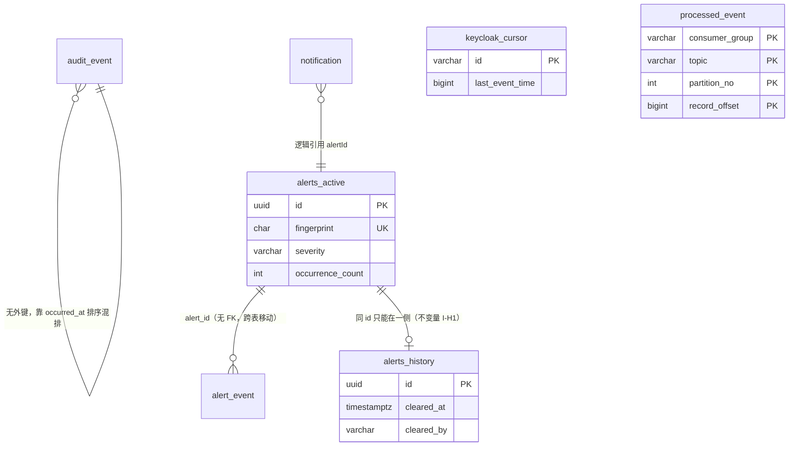

# 数据库说明 v1（schema-v1）

> 状态：v0.9 待评审。**逐列定义见 `02b-contract.md §2`**，本文件只做 ER、索引用途、造数与校验清单。
> SQL 唯一副本：`app/src/main/resources/db/migration/V1__init.sql`（T01 落地，按契约 §2 逐列生成）。

## 1. ER 概览



> `audit_event }o--|| audit_event` 是为表达「同表时间线」，实际不建自关联外键。

## 2. 表职责一览

| 表 | 谁写 | 谁读 | 生命周期 |
|---|---|---|---|
| `alerts_active` | alert（upsert） | alert、ai（经端口） | 行被清除时删除 |
| `alerts_history` | alert（移动时 insert） | alert、ai、audit（快照 SPI） | 只增不改 |
| `alert_event` | alert（每次上报） | alert（详情/证据） | 每告警保留最近 50 条 |
| `audit_event` | audit（`AuditWriter` 唯一入口） | audit（列表/导出） | 只增不改（二期留存策略） |
| `processed_event` | alert/notify（同事务） | 同左（幂等判定） | 本期不清理 |
| `keycloak_cursor` | audit（采集） | audit | 单行，只前进 |
| `notification` | notify | 验收查询 | 只增 |

## 3. 索引与查询对应

| 索引 | 表 | 支撑的查询 |
|---|---|---|
| `uq_alerts_active_fingerprint` | active | upsert 冲突目标（去重） |
| `idx_alerts_active_sort` | active | `#1` 默认排序 `severity_rank desc, last_seen_at desc` |
| `idx_alerts_active_source` | active | `#1` `source` 多值筛选 |
| `idx_alerts_active_lastseen` | active | `#1` 时间范围 |
| `pk_alerts_history` | history | `#4` 幂等主键、`#3` 按 id 回查 |
| `idx_alerts_history_cleared` | history | `#2` 默认排序与分页 |
| `idx_alerts_history_cleared_by` | history | `#2` 按处理人 |
| `idx_alerts_history_source` | history | `#2` 按来源 |
| `idx_alert_event_alert` | event | `#3` 最近 20 条事件 |
| `idx_audit_event_time` | audit | `#6/#7` 时间范围 + 倒序（NFR-04） |
| `idx_audit_event_actor` | audit | `#6` 按操作人 |
| `idx_audit_event_action` | audit | `#6` 按动作 |
| `idx_audit_event_outcome` | audit | `#6` 按结果 |
| `uq_audit_event_source_event` | audit | 采集幂等（部分唯一） |
| `pk_processed_event` | processed | 消费幂等 |
| `idx_notification_alert` | notification | 验收查询 |

未建索引的查询及理由：

- `#2 keyword ILIKE '%kw%'`：无 B-tree 可用；10 万行实测 <1s 则保留，否则提 ADR 上 `pg_trgm`。
- `#2` 的 `severity` 筛选走 `cleared_at` 索引后再过滤（历史表体量远小于审计表，可接受）。

## 4. 关键 SQL 索引（实现时直接引用）

| 场景 | 位置 |
|---|---|
| upsert 去重 + 事件写入 | `lld/02 §3.1` |
| 原子移动 | `lld/02 §3.2` |
| 列表（`count(*) over()`） | `lld/02 §3.3` |
| 审计写入/查询/导出 | `lld/03 §3.1–§3.3` |
| 采集游标 | `lld/03 §3.4` |
| 幂等台账 | `lld/05 §3.1` |
| 通知写入 | `lld/05 §3.2` |

## 5. 造数与性能验证

### 5.1 10 万行审计

```sql
insert into audit_event (id, occurred_at, actor, actor_type, action, target_type, target_id,
                         outcome, source, client_net, trace_id, detail)
select gen_random_uuid(),
       now() - (g || ' minutes')::interval,
       (array['zhangwei','liqiang','viewer01','wangfang'])[1 + (g % 4)],
       'USER',
       (array['LOGIN','LOGOUT','LOGIN_FAILED','ALERT_CLEARED','ACCESS_DENIED'])[1 + (g % 5)],
       (array['AUTH','ALERT','ENDPOINT'])[1 + (g % 3)],
       null,
       (array['SUCCESS','DENIED','FAILED'])[1 + (g % 3)],
       (array['APP','KEYCLOAK'])[1 + (g % 2)],
       '10.20.' || (g % 200) || '.0/24',
       'seed-' || g,
       '{"path":"/api/alerts/{id}/clear"}'::jsonb
from generate_series(1, 100000) g;
```

`gen_random_uuid()` 在 PG13+ 内置（无需扩展），符合「不使用扩展」约束。

度量：

```sql
explain (analyze, buffers)
select count(*) over () from audit_event
where occurred_at >= now() - interval '24 hours'
  and actor = 'zhangwei'
order by occurred_at desc limit 20;
```

记录实测值到 `docs/ai-log/T09.md`。

### 5.2 10 万行历史告警

```sql
insert into alerts_history (id, fingerprint, source, type, resource_id, event_code, severity,
    message, first_seen_at, last_seen_at, occurrence_count, latest_payload, latest_event_id,
    created_at, updated_at, cleared_at, cleared_by, cleared_reason, clear_mode)
select gen_random_uuid(), md5(g::text) || md5((g+1)::text), 'payment-api', '5xx',
       'res-' || g, '', 'HIGH', 'seed message ' || g || ' conn timeout',
       now() - interval '2 days', now() - interval '1 day', 3, '{}'::jsonb,
       gen_random_uuid(), now() - interval '2 days', now() - interval '1 day',
       now() - (g || ' minutes')::interval, 'seed', null, 'MANUAL'
from generate_series(1, 100000) g;
```

## 6. 迁移策略

- `V1__init.sql` 一次建全 7 张表 + 全部索引与约束；**不使用扩展**。
- Flyway 校验：`spring.flyway.validate-on-migrate=true`，`baseline-on-migrate=false`。
- 后续变更必须新版本文件（`V2__...`）+ ADR + 契约 §8 追加一行；**禁止改已发布迁移**。
- 约束命名统一：`pk_*` / `uq_*` / `ck_*` / `idx_*`，便于错误排查与后续 `drop constraint if exists`。

## 7. T01 落地校验清单

逐条在 T01 验收时执行：

| # | 校验 | 命令/断言 |
|---|---|---|
| 1 | 7 张表存在 | `\dt` 输出含 `alerts_active, alerts_history, alert_event, audit_event, processed_event, keycloak_cursor, notification` |
| 2 | 唯一索引存在 | `\d alerts_active` 含 `uq_alerts_active_fingerprint` |
| 3 | 部分唯一索引存在 | `\d audit_event` 含 `uq_audit_event_source_event` 且带 `WHERE` |
| 4 | 生成列生效 | 插入 `severity='CRITICAL'` 后 `severity_rank=4` |
| 5 | 约束生效 | 插入 `severity='WARN'` 报 `ck_alerts_active_severity` |
| 6 | 无扩展依赖 | `select extname from pg_extension` 只有 `plpgsql` |
| 7 | 时间列类型 | `\d alerts_active` 中 `first_seen_at` 为 `timestamptz` |
| 8 | 索引与契约一致 | 逐个核对 §3 表 |

## 8. 常见坑（写 SQL 前必读）

1. `partition` / `offset` 是保留字 → 用 `partition_no` / `record_offset`（契约 §2.5）。
2. `event_code` 不能存 NULL，否则唯一性对空值失效（契约 §2.1）。
3. `on conflict` 命中**部分唯一索引**时必须带谓词：`on conflict (source_event_id) where source_event_id is not null`。
4. 生成列不可在 `insert/update` 中赋值，只能读（含 `excluded.severity_rank`）。
5. `count(*) over ()` 与 `limit/offset` 同语句即可拿 total，不必二次 count。
6. 删除活动行后 `alert_event.alert_id` 仍有效（无 FK），不要加外键。
