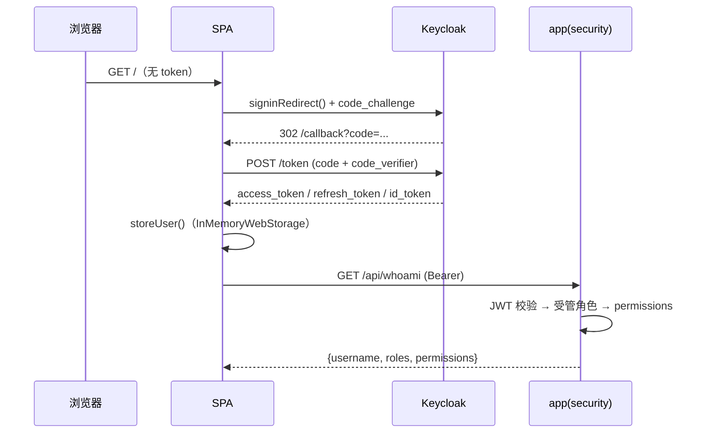
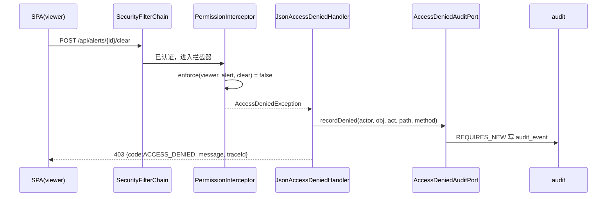

# LLD-01 认证与授权（auth）

> 状态：v0.9 待评审。覆盖 US-A1…A5，承接 T02（登录链路）、T03（Casbin 授权）。
> 字段与枚举见 `02b-contract.md`；本册只写行为、时序与边界。

## 1. 范围与边界

**负责**：

- 前端 OIDC 授权码 + PKCE 登录/登出/静默续期；token **仅内存**。
- 后端作为 OAuth2 资源服务器校验 JWT，解析 `realm_access.roles` → 受管角色。
- Casbin 策略判定（文件驱动）、`@RequirePermission` 注解拦截、**默认拒绝**。
- 401 / 403 的响应 envelope；403 触发审计（经 platform 端口）。
- `#11 /api/whoami`（角色与权限矩阵）与 `#12 /api/_perm/check`（非 prod 调试）。

**不负责**：

- 用户/密码/角色管理（全在 Keycloak realm；仓库只放 `keycloak/realm-export.json`）。
- 会话（无后端 session、无 cookie 鉴权）。
- 审计落库（本模块只调用 `AccessDeniedAuditPort`，实现与 `REQUIRES_NEW` 在 `audit`）。
- 业务权限语义（`alert:clear` 意味着什么，由 `lld/02` 决定）。

**依赖方向**：`security → platform`；`security` **不得** import `alert/audit/ai/notify`。
`app → security` 负责把 `whoami` 端点与前端静态资源装配起来。

**对外暴露**：

| 名称 | 位置 | 用途 |
|---|---|---|
| `CurrentActor`（record：`username`,`subject`,`roles`） | `security` | `audit` 取操作人；`alert` 清除时取 `clearedBy` |
| `PermissionService#isAllowed(Set<String>, String obj, String act)` | `security` | `#11` 计算 `permissions`；`#12` 判定 |
| `@RequirePermission(obj, act)` | 注解在 `platform`，拦截在 `security` | 所有 handler 必须标注 |

## 2. 领域模型

| 对象 | 说明 |
|---|---|
| `CurrentActor` | 从 `JwtAuthenticationToken` 解析：`username = preferred_username`，`subject = sub`，`roles = 受管角色集合` |
| `Permission(obj, act)` | 值对象；取值只能来自 `02b-contract.md §5.1` |
| `RoleSet` | 受管角色白名单 `{admin, operator, viewer, service}`；其余 JWT role 一律丢弃 |
| `PermissionEnforcer` | 包装 `org.casbin.jcasbin.Enforcer`，唯一入口 `enforce(role, obj, act)` |

不变量：

- **I-AUTH-1** 角色只来自 JWT，**不查库、不同步用户**。
- **I-AUTH-2** 对每个受管角色 `enforce`，**任一 allow 即通过**；无受管角色 = 拒绝。
- **I-AUTH-3** 匹配器只做 `==`，不允许 `keyMatch`/`regexMatch`（`02-design.md §4.1`）。
- **I-AUTH-4** 未标注 `@RequirePermission` 的 handler **默认 403**（安全默认，T03 验收项）。
- **I-AUTH-5** 策略文件改动后需重启生效；不做热加载（US-A5 口径）。
- **I-AUTH-6** 前端 token 只存内存；任何 `localStorage/sessionStorage` 写入 = 违规。

## 3. 数据访问

**本模块不访问业务表。** 策略与模型是打包进 jar 的 classpath 资源：

```
security/src/main/resources/casbin/model.conf   （02b-contract.md §5.2）
security/src/main/resources/casbin/policy.csv   （02b-contract.md §5.3）
```

- 启动时 `Enforcer` 加载一次；文件缺失或解析失败 → **启动失败**（不允许「空策略启动」导致全站 403）。
- `audit_event` 由 `audit` 写，本模块只经端口调用，不写 SQL。

## 4. 关键时序

### 4.1 登录



断言：刷新页面不出现登录页（`automaticSilentRenew`）；`localStorage`/`sessionStorage` 搜不到 token；删掉内存 user 后 `#11` 返回 401。

### 4.2 越权（403 + 审计）



断言：403 后 1 秒内 `audit_event` 出现 `ACCESS_DENIED/DENIED`（`target_id='alert:clear'`，`detail.requestedObj/requestedAct` 有值）；审计写失败**不得**影响 403 返回（catch + `audit_write_failed` 计数）。

### 4.3 改策略即改行为（US-A5 演示）

`policy.csv` 加 `p, viewer, alert, clear` → 重启 → viewer 的 `#12?obj=alert&act=clear` 返回 `allowed=true`，`#4` 由 403 变 200。

## 5. 接口清单

| # | 方法路径 | 权限 | 要点 |
|---|---|---|---|
| 11 | `GET /api/whoami` | `whoami:read` | `username/subject/roles/permissions`；`permissions` 对 §5.1 全量 `obj×act` 求值；无 token → 401 |
| 12 | `GET /api/_perm/check?obj&act` | `_perm:check` | 仅 `app.security.test-endpoints=true` 且非 prod；未知 obj/act → 400 |

字段与错误码见 `02b-contract.md §3`（#11、#12）。

**前端账号入口（UI 增量，无新端点、无新 US）**

| 入口 | 目标 | 说明 |
|---|---|---|
| `Profile` | `{issuer}/account/` | Keycloak Account Console 首页 = 个人信息（firstName / lastName / email） |
| `Password` | `{issuer}/account/account-security/signing-in` | Account Console 的「Signing in」页改密码 |
| `Keycloak Admin console` | `{keycloak}/admin/{realm}/console/` | 需 realm 管理员；普通账号由 Keycloak 拒绝 |

- 三个入口都是浏览器跳转，应用**不**读写这些字段，因此不涉及 `02b-contract.md` 的任何 DTO。
- 为什么不应用内直调：Admin API 前端禁用（`AGENTS.md §2.1.6`）；Account REST API 虽然存在，
  但 Keycloak 26 的真实响应不带 CORS 头（实测 preflight 有 `Access-Control-Allow-Origin`，GET/POST 没有），
  从 `:8080` 跨源直连会被浏览器拦截。要做应用内表单，必须加后端代理端点并同步改契约。
- 前提：`operator` / `viewer` 需要 `account` 客户端角色 `view-profile`、`manage-account`
  （`keycloak/realm-export.json` 已补；缺这两个角色时 Account Console 读不到资料）。

## 6. 事务与一致性

- 本模块**无业务事务**；`PermissionService`、`JwtRoleConverter` 都是纯内存操作。
- 审计写入的事务语义在 `audit`（`REQUIRES_NEW`）；本模块只保证「调用发生在 403 响应写出之前」，使「403 与审计同时可查」成立。
- 不缓存判定结果：策略小、`enforce` 微秒级；缓存会破坏 US-A5 的「改配置即生效」直觉。

## 7. 错误与审计点

| 触发 | 组件 | 输出 | 审计 |
|---|---|---|---|
| 无/非法/过期 token | `JsonAuthenticationEntryPoint` | `401 {"code":"UNAUTHORIZED",…}` | **不记**（防扫描刷表，I-C4） |
| 权限不足 | `PermissionInterceptor` → `JsonAccessDeniedHandler` | `403 {"code":"ACCESS_DENIED",…}` | **记 1 条** `ACCESS_DENIED/DENIED` |
| handler 未标注注解 | 同上 | 403 | 记（`targetId` 用推断的 `obj:act`，无则 `unknown:unknown`） |
| 策略文件缺失/非法 | 启动期 | 启动失败 + 明确日志 | — |

实现约束：

- 403 审计**必须**写在 `JsonAccessDeniedHandler`；`@RestControllerAdvice` 收不到该异常（`ExceptionTranslationFilter` 已在过滤器链处理）。
- 401/403 都输出统一 envelope；`traceId` 与审计行一致。
- 日志禁止出现 token / Authorization 头 / 完整 IP。

## 8. 配置与运行

| 键 | 来源 | 说明 |
|---|---|---|
| `spring.security.oauth2.resourceserver.jwt.issuer-uri` | env `KEYCLOAK_ISSUER_URI` | 必须与浏览器用的是同一 realm |
| `app.security.test-endpoints` | 默认 false | `#12` 开关；prod 必须 false |

前端（`frontend/src/auth/`）：

| 项 | 值 |
|---|---|
| `authority` | `VITE_KEYCLOAK_URL/realms/triagedeck` |
| `client_id` | `triagedeck-spa`（public client，`pkce S256`） |
| `redirect_uri` | `${origin}/callback` |
| `response_type` | `code` |
| `scope` | `openid profile email` |
| `userStore` | `new WebStorageStateStore({ store: new InMemoryWebStorage() })` |
| `automaticSilentRenew` | `true`（refresh_token 授权，不依赖三方 cookie） |

- Keycloak client 建议：`access.token.lifespan=300s`、`sso.session.idle=30m`。
- 路由守卫：无 user → `signinRedirect()` 并记 `state.returnTo`；`apiClient` 遇 401 → 清内存 user 并跳登录。
- 开发期 `vite.config.ts` 代理 `/api → http://localhost:8080`，避免 CORS。

## 9. 测试计划

| 类型 | 用例 | 覆盖 | 「改坏必然红」的断言 |
|---|---|---|---|
| 单测 | `JwtRoleConverterTest.should_keep_only_managed_roles()` | A3 | 结果**不含** `offline_access`；白名单改空会红 |
| 单测 | `JwtRoleConverterTest.should_return_empty_when_no_managed_role()` | A3 | 空角色 → 空集，不是默认 operator |
| 单测 | `PermissionServiceTest.should_allow_when_any_role_allows()` | A3 A5 | viewer+operator → clear 允许 |
| 单测 | `PermissionServiceTest.should_flip_when_policy_changes()` | A5 | 内存 policy 改一行 → 结果翻转 |
| 单测 | `CasbinModelTest.should_not_match_wildcard()` | A4 | `enforce(operator, alert, "*")` 必须 false |
| 单测 | `JsonAccessDeniedHandlerTest.should_write_envelope_and_audit()` | A4 C3 | body 三字段齐全 + 端口调用一次 |
| 集成 | `WhoamiIT.should_return_roles_and_permissions()` | A1 A3 | `roles=["operator"]`、`permissions` 含 `alert:clear` |
| 集成 | `WhoamiIT.should_return_401_when_no_token()` | A1 | 401 envelope |
| 集成 | `PermissionCheckIT.should_flip_between_viewer_and_operator()` | A3 A5 | viewer false / operator true |
| 集成 | `UndeclaredEndpointIT.should_return_403_when_annotation_missing()` | A4 | 无注解 handler → 403 |
| ArchUnit | `SecurityArchTest` | — | `security` 不依赖业务模块 |

验收命令：

```bash
./gradlew :security:test
curl -s -o /dev/null -w '%{http_code}\n' localhost:8080/api/whoami            # 401
curl -s -H "Authorization: Bearer $VIEWER"   'localhost:8080/api/_perm/check?obj=alert&act=clear'  # {"allowed":false}
curl -s -H "Authorization: Bearer $OPERATOR" 'localhost:8080/api/_perm/check?obj=alert&act=clear'  # {"allowed":true}
```

## 附录 A：待确认项

| # | 问题 | 建议 | 结论 |
|---|---|---|---|
| A1 | `whoami.permissions` 是否也返回 `service` 角色的集合？ | 返回（前端不展示 service 用户） | |
| A2 | 是否信任 `X-Forwarded-For`？ | 本期不信任，直接用 `getRemoteAddr`（演示无代理） | |
| A3 | `ingest-service` client secret 如何注入？ | `.env` → compose env → 与 `app.keycloak.admin.client-secret` 同源，不落仓库 | |
