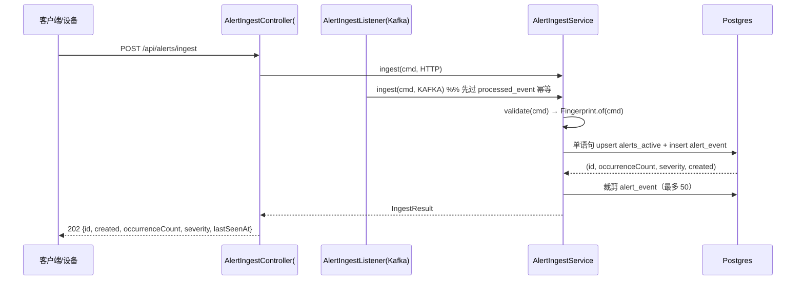
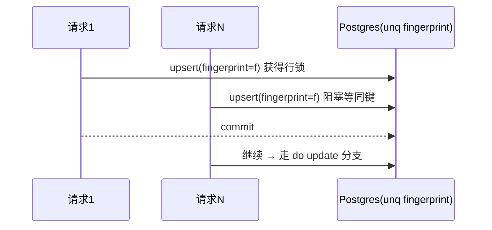
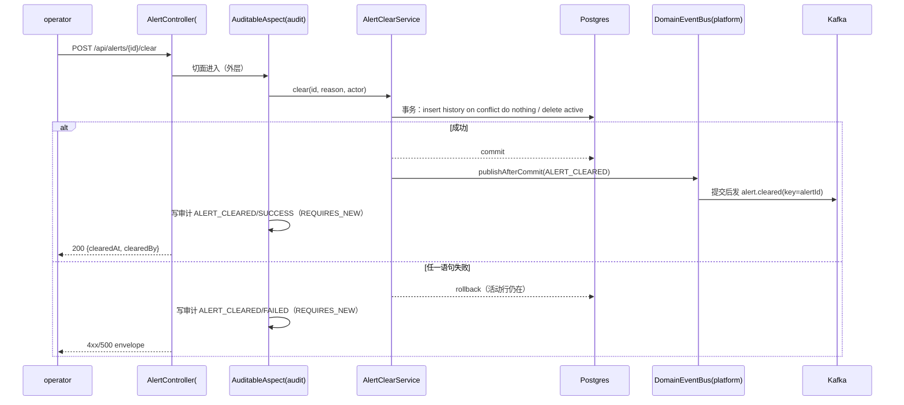

# LLD-02 告警（alert）

> 状态：v0.9 待评审。覆盖 US-B1…B6（B7 二期），承接 T04（摄入去重）、T05（列表详情）、T06（清除）、T07（历史）。
> 字段见 `02b-contract.md §2.1–§2.3`、`§3 #1–#5`；不变量见 `02-design.md §2.5 §2.6`。

## 1. 范围与边界

**负责**：

- 摄入：HTTP `#5` 与 Kafka `alert.ingested` 走**同一个**入口 service；fingerprint 计算与 upsert 去重。
- 活动列表 `#1`、详情 `#3`、历史 `#2`、清除 `#4`。
- 每次上报落 `alert_event` 并裁剪（最近 50 条）；维护 `latest_payload`。
- 清除成功后发布 `alert.cleared`（提交后）。
- 对外只读端口 `AlertReadPort`（供 `ai`）与审计快照 SPI `AuditTargetResolver`（供 `audit`）。

**不负责**：

- 审计行的写入与切面（在 `audit`）；本模块只加 `@Auditable` 注解。
- Kafka 连接、幂等台账、DLT 配置（在 `platform`），本模块只写监听器并复用幂等包装。
- 任何导出（CSV 只在审计 `#7`）。
- 自动清除（US-B7，二期）。

**依赖**：`alert → platform, security`。**不得** import `audit/ai/notify`。

## 2. 领域模型

| 对象 | 说明 |
|---|---|
| `AlertAggregate`（对应 `alerts_active`/`alerts_history`） | 聚合体：四段合并键 + `occurrenceCount` + `severity` + 时间窗 + 最新 payload |
| `IngestCommand`（record） | `source, type, resourceId, eventCode, severity, message, occurredAt, payload`；`#5` 与 Kafka 共用 |
| `Fingerprint`（值对象） | 纯函数 `of(IngestCommand) → String(64 hex)`，见契约 §1.5 |
| `MergeFields` | `{source,type,resourceId,eventCode}`，详情页展示「为什么合并成一条」 |
| `AlertStatus` | `ACTIVE` / `CLEARED`（只在视图里出现，DB 用两张表表达） |
| `AlertReadPort` | `findDetail(UUID)` / `query(AlertFilter, page, size)`，包 `alert.api.port` |
| `AlertAuditTargetResolver` | 实现 `platform` 的 `AuditTargetResolver`，`targetType()="ALERT"` |

不变量（继承 `02-design.md §2.5/§2.6` 的 I-D*、I-M*），本册补充：

- **I-AL-1** 一次摄入只产生一次 `alerts_active` 写入（单语句 upsert），事件写入与聚合写入在同一事务。
- **I-AL-2** `severity` 只升不降；`last_seen_at` 只前进（`greatest`）。
- **I-AL-3** `message`/`latest_payload` 总是最新一次上报的值（便于详情页看「最近一次到底说了什么」）。
- **I-AL-4** 清除只移动、不修改业务字段（`occurrence_count` 等原样搬走）。
- **I-AL-5** 列表排序永远服务端完成；前端不得二次排序/过滤（T05 禁止项）。
- **I-AL-6** 历史查询 `size>100` 夹取为 100，不报错（T07 验收）。

## 3. 数据访问

### 3.1 摄入（单语句 upsert + 事件写入）

```sql
with upsert as (
  insert into alerts_active (
    id, fingerprint, source, type, resource_id, event_code, severity,
    message, first_seen_at, last_seen_at, occurrence_count,
    latest_payload, latest_event_id, created_at, updated_at
  ) values (
    :alertId, :fingerprint, :source, :type, :resourceId, :eventCode, :severity,
    :message, :occurredAt, :occurredAt, 1,
    :payload::jsonb, :eventId, now(), now()
  )
  on conflict (fingerprint) do update set
    occurrence_count = alerts_active.occurrence_count + 1,
    last_seen_at     = greatest(alerts_active.last_seen_at, excluded.last_seen_at),
    severity         = case when excluded.severity_rank > alerts_active.severity_rank
                            then excluded.severity else alerts_active.severity end,
    message          = excluded.message,
    latest_payload   = excluded.latest_payload,
    latest_event_id  = excluded.latest_event_id,
    updated_at       = now()
  returning id, occurrence_count, severity, (xmax = 0) as created
), ev as (
  insert into alert_event (id, alert_id, occurred_at, received_at, severity, message, payload, ingress)
  select :eventId, upsert.id, :occurredAt, now(), :severity, :message, :payload::jsonb, :ingress
  from upsert
)
select id, occurrence_count, severity, created from upsert;
-- 返回 id → 供下一条裁剪语句使用（trim）

-- 同事务第 2 条：裁剪
delete from alert_event
where alert_id = :alertIdFromUpsert
  and id not in (
    select id from alert_event where alert_id = :alertIdFromUpsert
    order by occurred_at desc, id desc limit 50
  );
```

要点：

- `:alertId` 是本请求预生成的新 UUID；**冲突时不使用它**（沿用已存在行的 id）。
- `created` 用 `(xmax = 0)` 判定（Postgres 实现细节）；必须在集成测试里覆盖「首次 true / 重复 false」。
- `excluded.severity_rank` 是生成列，只读可用；`severity` 列本身**不可**在 upsert 里直接赋 rank。
- 两条语句在同一 `@Transactional` 内；并发 20 请求由唯一索引串行化，最终 `occurrence_count=20`。
- 索引命中：`uq_alerts_active_fingerprint`（冲突路径）；无额外索引维护，满足 NFR-03。

### 3.2 清除（原子移动）

```sql
with moved as (
  insert into alerts_history (
    id, fingerprint, source, type, resource_id, event_code, severity,
    message, first_seen_at, last_seen_at, occurrence_count,
    latest_payload, latest_event_id, created_at, updated_at,
    cleared_at, cleared_by, cleared_reason, clear_mode
  )
  select a.id, a.fingerprint, a.source, a.type, a.resource_id, a.event_code, a.severity,
         a.message, a.first_seen_at, a.last_seen_at, a.occurrence_count,
         a.latest_payload, a.latest_event_id, a.created_at, a.updated_at,
         now(), :actor, :reason, 'MANUAL'
  from alerts_active a
  where a.id = :id
  on conflict (id) do nothing
  returning id
)
delete from alerts_active a using moved m where a.id = m.id
returning a.id;
```

错误分类（事务内、只读一次）：

1. `moved`/`delete` 返回 1 行 → 成功，返回 `{id, clearedAt, clearedBy}`。
2. 返回 0 行 → 查 `alerts_history` 是否存在该 id：存在 → `ALREADY_CLEARED`(409)；不存在 → `ALERT_NOT_FOUND`(404)。

该「事后查询」仅用于错误分类，不参与去重（不违反「禁止先 select 再 insert」）。

### 3.3 列表与详情

活动列表（单查询，`count(*) over()` 拿 total，避免二次全表 count）：

```sql
select a.id, a.severity, a.source, a.type, a.resource_id, a.event_code, a.message,
       a.first_seen_at, a.last_seen_at, a.occurrence_count, a.fingerprint,
       count(*) over () as total
from alerts_active a
where (cast(:severities as text[]) is null or a.severity = any(:severities))
  and (cast(:sources    as text[]) is null or a.source   = any(:sources))
  and (:from is null or a.last_seen_at >= :from)
  and (:to   is null or a.last_seen_at <= :to)
order by a.severity_rank desc, a.last_seen_at desc, a.id
limit :size offset :offset;
```

历史列表同构（表换 `alerts_history`、时间列换 `cleared_at`、排序 `cleared_at desc, id`，另加 `cleared_by = :clearedBy` 与 `message ilike '%'||:keyword||'%'`）。

详情：先查 `alerts_active`，未命中再查 `alerts_history`；再取 `select ... from alert_event where alert_id=:id order by occurred_at desc, id desc limit 20`。

索引对应关系：`idx_alerts_active_sort`（默认页）、`idx_alerts_active_source`、`idx_alerts_active_lastseen`、`idx_alerts_history_cleared`、`idx_alerts_history_cleared_by`、`idx_alerts_history_source`。
关键字查询无专用索引（`ILIKE` 全扫），T07 用 10 万行实测，>1s 才评估 `pg_trgm`（需 ADR）。

级别计数看板（US-B8，前端增量，不新增端点）：复用 `#1`，按 `severity` 各查一次 `page=0&size=1`，只读返回的 `total`（服务端 count 查询，WHERE 条件与列表一致）；前端每 10 秒刷新，清除告警后立即重新取数。

## 4. 关键时序

### 4.1 摄入去重（HTTP 与 Kafka 同一条路径）



断言：

- 12 次同指纹 → 1 行、`occurrence_count=12`、`alert_event` 12 条（≤50 不裁剪）。
- 只改 `message` 里的数字 → 仍 1 行、count+1。
- 只改 `resourceId` → 新行（新 fingerprint）。
- `HIGH → CRITICAL` → 同行、`severity=CRITICAL`；`severity_rank` 由生成列自动更新。
- 缺 `type`/`source` → 400，且**不落任何行**（校验在写库之前）。

### 4.2 并发同一 fingerprint



断言：20 并发 → 1 行、`occurrence_count=20`；唯一键冲突**不得**冒到 500（已被 upsert 吸收）。

### 4.3 清除（含回滚与下游）



断言：回滚场景 `alerts_active` 仍有该行、`alerts_history` 没有、Kafka 无消息、审计有 1 条 `FAILED`。

## 5. 接口清单

| # | 方法路径 | 权限 | 要点 |
|---|---|---|---|
| 1 | `GET /api/alerts/active` | `alert:read` | 多值 `severity`/`source`、`from/to` 作用于 `lastSeenAt`；服务端排序；空集合返回 `items:[]` |
| 2 | `GET /api/alerts/history` | `alert:read` | `clearedBy`/`keyword`/`severity`/`source`/`from/to`；排序 `clearedAt desc`；**不做导出** |
| 3 | `GET /api/alerts/{id}` | `alert:read` | 活动/历史通用；含 `mergeFields`/`mergeRule`/`latestPayload`/`events[≤20]` |
| 4 | `POST /api/alerts/{id}/clear` | `alert:clear` | 幂等靠主键；`reason` 可空；404/409 |
| 5 | `POST /api/alerts/ingest` | `alert:ingest` | 202 + `{id,created,occurrenceCount,severity,lastSeenAt}`；忽略客户端 `fingerprint` |

返回结构见 `02b-contract.md §3.0`（`AlertView` / `AlertHistoryView` / `AlertDetailView`）。

## 6. 事务与一致性

| 方法 | 事务 | 说明 |
|---|---|---|
| `AlertIngestService.ingest(...)` | `@Transactional` | upsert + 事件写入 + 裁剪，三条语句一个事务 |
| `AlertClearService.clear(...)` | `@Transactional` | 原子移动；成功后 `publishAfterCommit` |
| 列表/详情/历史查询 | `@Transactional(readOnly = true)` | 详情读两张表 + 事件表，需同一快照 |
| `AlertReadPort.query(...)` | 复用列表查询方法 | 供 `ai`，只读 |

- `alert.cleared` 必须**提交后**发（`02-design.md §5.3`）；`publishAfterCommit` 在无事务时立即发，禁止在事务体内 `send`。
- 禁止应用层锁（`synchronized`、分布式锁）；并发正确性由唯一索引与主键提供。
- 同类内不得自调用 `@Transactional` 方法（AGENTS §2.2.7）。

## 7. 错误与审计点

| 场景 | 异常/返回 | 审计 |
|---|---|---|
| 校验失败（缺字段/超长/枚举非法/时间越界） | `BizException(VALIDATION_FAILED, 400)` | 无（未进入业务动作） |
| 清除时 id 不在两表 | `BizException(ALERT_NOT_FOUND, 404)` | 切面记 `ALERT_CLEARED/FAILED` |
| 重复清除 | `BizException(ALREADY_CLEARED, 409)` | 切面记 `ALERT_CLEARED/FAILED`（保留 targetId 便于追查） |
| 权限不足 | 拦截器 → 403 | `ACCESS_DENIED/DENIED`（由 security 写） |
| 成功清除 | — | `ALERT_CLEARED/SUCCESS` + 快照（`detail.alert`） |

`@Auditable` 标注：

```java
@Auditable(action = ALERT_CLEARED, targetType = ALERT, targetIdParam = "id")
@Transactional
public ClearResult clear(UUID id, String reason, CurrentActor actor) { … }
```

- `targetIdParam` 依赖编译参数 `-parameters`（Spring Boot Gradle 插件默认开启）；缺失则退化为 `targetId=null` 并在启动期告警。
- **T06 先加注解**（切面 T08 才实现）；注解本身无副作用，保证 T08 不回头改业务代码。
- 审计的告警快照由 `AlertAuditTargetResolver` 提供（清除后从 `alerts_history` 读）；读不到时退化为 `{path,method}`。
- 摄入不记审计（US-C2 只要求「清除」）；上报量大，记账会污染时间线。

## 8. 配置与运行

| 键 | 默认 | 说明 |
|---|---|---|
| `app.kafka.topics.ingested` | `alert.ingested` | 监听器订阅 |
| `app.kafka.consumer.group.ingest` | `triagedeck-alert-ingest` | 消费组 |
| `spring.jackson.deserialization.fail-on-unknown-properties` | `false` | 允许上报方多带字段 |

- 启动期自检：`alerts_active` 唯一索引存在，否则 fail-fast（去重失效比启动失败更危险）。
- `payload` ≤64KB 由 `@Valid` + 服务端长度检查双保险（DB 无 jsonb 长度约束）。
- 前端代理见 `lld/01 §8`；列表页用 TanStack Query，`staleTime=10s`，清除成功后 `invalidateQueries(['alerts','active'])` 与 `['alerts','history']`。

前端落点（T05/T06/T07）：

| 文件 | 内容 |
|---|---|
| `features/alerts/api.ts` | `useActiveAlerts(filter)` / `useHistory(filter)` / `useAlertDetail(id)` / `useClearAlert()`（全部 TanStack Query，无 `useEffect` fetch） |
| `features/alerts/components/AlertTable.tsx` | 展示列：严重级别、来源、类型、资源、首次/最近发生、次数；空态文案「当前没有活动告警」 |
| `features/alerts/components/AlertDetailPanel.tsx` | `mergeFields` 四段 + `mergeRule` + `events` 列表 |
| `features/alerts/components/ClearDialog.tsx` | `reason` 可空；按钮显隐由 `whoami.permissions` 里是否有 `alert:clear` 决定 |

## 9. 测试计划

| 类型 | 用例 | 覆盖 | 「改坏必然红」的断言 |
|---|---|---|---|
| 单测 | `FingerprintTest.should_ignore_case_and_whitespace()` | B2 | `" Payment-API "` 与 `"payment-api"` 同指纹；删 `toLowerCase` 必红 |
| 单测 | `FingerprintTest.should_treat_null_event_code_as_empty()` | B2 | `null` 与 `""` 同指纹；保留 null 必红 |
| 单测 | `FingerprintTest.should_not_swap_segment_order()` | B2 | `source=a,type=b` 与 `source=b,type=a` 不同 |
| 单测 | `IngestValidatorTest.should_reject_when_type_missing()` | B1 | 400 `VALIDATION_FAILED` |
| 单测 | `IngestValidatorTest.should_reject_severity_alias()` | B1 | `WARN` 被拒 |
| 集成 | `IngestIT.should_merge_12_occurrences_into_one_row()` | B1 B2 | 1 行 + count=12 + 12 条事件 |
| 集成 | `IngestIT.should_upgrade_severity_without_downgrade()` | B2 | HIGH→CRITICAL 升；再发 LOW 仍 CRITICAL |
| 集成 | `IngestIT.should_create_new_row_when_resource_changes()` | B2 | 2 行 |
| 集成 | `IngestIT.should_keep_one_row_under_20_concurrent()` | B2 | 1 行 + count=20（`CompletableFuture` 并发） |
| 集成 | `IngestIT.should_report_created_flag()` | B2 | 首次 true、重复 false（覆盖 `xmax`） |
| 集成 | `ActiveListIT.should_sort_by_severity_then_last_seen()` | B3 | 顺序断言到 id 级别 |
| 集成 | `ActiveListIT.should_return_empty_page_when_no_data()` | B3 | `items=[]`、`total=0` |
| 集成 | `AlertDetailIT.should_return_merge_fields()` | B4 | `mergeFields` 四段齐全 |
| 集成 | `ClearIT.should_move_to_history_atomically()` | B5 | active 0 行、history 1 行且 id 相同 |
| 集成 | `ClearIT.should_return_409_when_cleared_twice()` | B5 | 409 + history 仍 1 行 |
| 集成 | `ClearIT.should_rollback_when_history_insert_fails()` | B5 | 用 `CHECK` 违规模拟失败 → active 仍在 |
| 集成 | `HistoryIT.should_filter_by_cleared_by_and_keyword()` | B6 | 只返回匹配行 |
| 集成 | `HistoryIT.should_clamp_size_over_100()` | B6 | `size=500` → 响应 `size=100`，无 400 |
| ArchUnit | `AlertArchTest` | — | 不依赖 `audit/ai/notify`；controller 不碰 repo |

验收命令：

```bash
./gradlew :alert:test
docker compose exec postgres psql -U triagedeck -c 'select count(*), sum(occurrence_count) from alerts_active'
```

## 附录 A：待确认项

| # | 问题 | 建议 | 结论 |
|---|---|---|---|
| A1 | `alert_event` 每告警 50 条上限是否够 US-D1 证据链 | 够（近因事件即可；更早数据二期做冷表） | |
| A2 | 列表 `message` 是否截断 | 不截断（≤4000），前端 `line-clamp` 控制视觉 | |
| A3 | 详情 `events[]` 是否需要带 `payload` | 不带（避免响应膨胀），二期加单事件端点 | |
| A4 | 历史关键字是否也搜 `resourceId` | 只搜 `message`（按 US-B6 原文） | |
