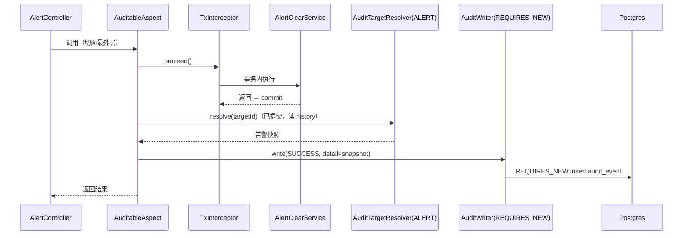
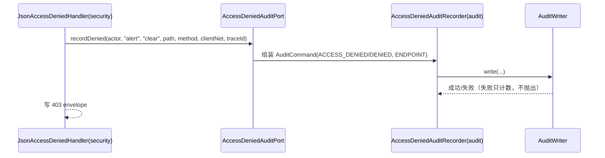
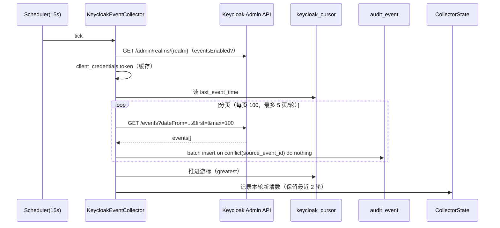

# LLD-03 审计（audit）

> 状态：v0.9 待评审。覆盖 US-C1…C5（C6 二期），承接 T08（写入）、T09（采集 + 审计页）。
> 字段见 `02b-contract.md §2.4 §2.6 §6`、`§3 #6 #7`；模型见 `02-design.md §6`。

## 1. 范围与边界

**负责**：

- 审计行的唯一写入口 `AuditWriter`（`REQUIRES_NEW`）。
- `@Auditable` 切面：成功/失败各写一条，位置在事务拦截器外层。
- 实现 platform 端口 `AccessDeniedAuditPort`（403 由 security 触发调用）。
- 实现 `AuditDetailSanitizer`（白名单 + 脱敏）、`IpMasker`。
- Keycloak 事件采集（定时 + 游标 + 幂等 + 采集状态）。
- 查询 `#6`、CSV 导出 `#7`；前端审计时间线页。

**不负责**：

- 权限判定（security）、告警业务（alert）。
- Keycloak 用户/角色管理；不把用户同步进任何本地表。
- 哈希链完整性校验（US-C6，二期）。

**依赖**：`audit → platform, security`。**不得** import `alert`（告警快照经 `platform` SPI 获取）。

## 2. 领域模型

| 对象 | 说明 |
|---|---|
| `AuditCommand`（record） | `actor, actorType, action, targetType, targetId, outcome, source, sourceEventId, detail(Map), clientNet, traceId, occurredAt` |
| `AuditWriter#write(AuditCommand)` | 唯一写入口；内部 `REQUIRES_NEW` |
| `AuditableAspect` | 拦截 `@Auditable`；`@Order(LOWEST_PRECEDENCE - 10)` |
| `AccessDeniedAuditPort` 实现（`AccessDeniedAuditRecorder`） | 组装 `ACCESS_DENIED/DENIED` 命令并调用 `AuditWriter` |
| `AuditTargetResolver`（platform SPI，本模块消费） | 按 `targetType` 取快照（`ALERT` 由 alert 实现） |
| `AuditDetailSanitizer` | 键黑名单 + 值截断 + 去换行 |
| `IpMasker` | IPv4 /24、IPv6 /64，见契约 §6.2 |
| `KeycloakEventCollector` | 定时任务 + 游标推进 |
| `CollectorState`（内存） | `lastRunAt`、`lastTwoCounts`；对外暴露 `eventsCollected/eventsDisabled` |

不变量：继承 `02-design.md §2.3` 的 I-C1…I-C5；本册补充：

- **I-AU-1** 审计写入失败**不得**让主业务失败：异常全捕获 + `audit_write_failed` 计数 + error 日志（不带业务数据）。
- **I-AU-2** `detail` 只来自白名单键（契约 §6.1），写入前必须过 `Sanitizer`，**唯一入口**不允许旁路。
- **I-AU-3** `source='KEYCLOAK'` 必须带 `source_event_id`，重复拉取不产生第二行。
- **I-AU-4** 401 永不产生审计行。
- **I-AU-5** 审计无更新/删除路径（没有对应 service 方法、没有 DELETE SQL）。

## 3. 数据访问

### 3.1 写入（单行 insert）

```sql
insert into audit_event (id, occurred_at, recorded_at, actor, actor_type, action,
                         target_type, target_id, outcome, source, source_event_id,
                         client_net, trace_id, detail)
values (:id, :occurredAt, now(), :actor, :actorType, :action,
        :targetType, :targetId, :outcome, :source, :sourceEventId,
        :clientNet, :traceId, :detail::jsonb);
```

采集批量写法（幂等，部分唯一索引需带谓词）：

```sql
insert into audit_event (...)
values (...)
on conflict (source_event_id) where source_event_id is not null do nothing
returning id;
```

- 返回行数 > 0 视为「本轮有新事件」。
- 索引命中：`uq_audit_event_source_event`（部分唯一）。

### 3.2 查询（`#6`）

```sql
select e.id, e.occurred_at, e.actor, e.actor_type, e.action, e.target_type, e.target_id,
       e.outcome, e.source, e.client_net, e.trace_id, e.detail,
       count(*) over () as total
from audit_event e
where e.occurred_at >= :from
  and (:to is null or e.occurred_at <= :to)
  and (:actor is null or e.actor = :actor)
  and (cast(:actions as text[]) is null or e.action = any(:actions))
  and (cast(:outcomes as text[]) is null or e.outcome = any(:outcomes))
order by e.occurred_at desc, e.id
limit :size offset :offset;
```

`from` **必填**（NFR-04 的前提）；跨度 ≤90 天（契约 §1.6）。索引：`idx_audit_event_time` 打底，其余三个复合索引按筛选列命中。

### 3.3 导出（`#7`）

两步，避免「先写响应头再发现超限」：

1. 计数：`select count(*) from (select 1 from audit_event where <同 #6 条件> limit 50001) t` → >50000 → 422 `EXPORT_TOO_LARGE`。
2. 流式：`JdbcTemplate.queryForStream(...)` 逐行写 `HttpServletResponse.getOutputStream()`，每 500 行 `flush()`。

- 表头固定十列（契约 §3 #7）；值一律经 `CsvEscaper`（含 `"`、`,`、换行时加引号并转义）。
- 首字节写 UTF-8 BOM，Excel 打开中文不乱码。
- 导出**不受分页参数影响**；`page/size` 传入即忽略（避免误以为只导出当前页）。

### 3.4 游标

```sql
insert into keycloak_cursor (id, last_event_time, last_event_id, updated_at)
values ('realm-events', :time, :eventId, now())
on conflict (id) do update set
  last_event_time = greatest(keycloak_cursor.last_event_time, excluded.last_event_time),
  last_event_id   = case when excluded.last_event_time >= keycloak_cursor.last_event_time
                         then excluded.last_event_id else keycloak_cursor.last_event_id end,
  updated_at      = now();
```

游标只前进（`greatest`）；同毫秒用 `last_event_id` 辅助，避免漏事件。

## 4. 关键时序

### 4.1 清除成功 → 审计（切面在外层）



断言：`detail.alert.occurrenceCount` 与历史行一致；把切面 `@Order` 调到事务内层 → 「主业务回滚审计仍在」测试必红。

### 4.2 越权（403 由 security 调用端口）



断言：`target_id='alert:clear'`、`detail.requestedObj/requestedAct` 有值、`client_net` 是网段；**审计失败时 403 仍返回**。

### 4.3 采集一轮



断言：

- 同一批事件拉两轮 → `audit_event` 行数不变（幂等）。
- 登录 → 30 秒内出现 `LOGIN/SUCCESS`，`source=KEYCLOAK`。
- 输错密码 → `LOGIN_FAILED/FAILED`，`detail.error='invalid_user_credentials'`。
- 两轮 0 新增 → `eventsCollected=false`；`eventsEnabled=false` → `eventsDisabled=true`。

## 5. 接口清单

| # | 方法路径 | 权限 | 要点 |
|---|---|---|---|
| 6 | `GET /api/audit/events` | `audit:read` | `from` 必填；`actor`/`action[]`/`outcome[]`；附带 `eventsCollected/eventsDisabled/collectorLastRunAt` |
| 7 | `GET /api/audit/events/export` | `audit:export` | CSV + BOM；十列固定；>50000 行 422 |

字段见 `02b-contract.md §3`（#6、#7）与 `§3.0`（`AuditEventView`）。

前端（`features/audit/`）：

| 文件 | 内容 |
|---|---|
| `api.ts` | `useAuditEvents(filter)`；导出用 `fetch` + `Blob` 下载（token 只在内存，**不能**用 `<a href>`） |
| `components/AuditTimeline.tsx` | 时间倒序；`outcome=DENIED` 红色标记；与告警记录混排 |
| `components/AuditFilters.tsx` | 操作人/动作/结果/时间范围；`from` 默认最近 24h |
| `components/CollectorNotice.tsx` | `eventsCollected=false` → 「身份系统未采集到数据（最长 30 秒延迟）」；`eventsDisabled=true` → 「身份系统未开启事件记录」 |

导出实现：`fetch(url,{headers:{Authorization}})` → `blob()` → `URL.createObjectURL` → 触发下载；禁止把 token 拼进 URL。

## 6. 事务与一致性

| 组件 | 事务 | 说明 |
|---|---|---|
| `AuditWriter.write(...)` | `@Transactional(propagation = REQUIRES_NEW)` | 独立提交；主业务回滚不影响 |
| 采集一轮 | `@Transactional` | 每页读 → 写 → 游标推进同事务 |
| 查询 / 导出 | `readOnly` | 导出用流式游标，不回表 |

- `AuditWriter` 是**唯一**写入口：业务模块禁止 `auditRepository.save(...)`。
- 切面捕获审计自身异常，只计数与日志，不向上抛。
- 采集失败（网络/401）只记 `collector_error` 与 `lastRunAt`，**不写审计**（避免自指刷表）。

## 7. 错误与审计点

| 场景 | 行为 | 审计 |
|---|---|---|
| 业务成功 | 切面写 `SUCCESS` | 1 条 |
| 业务抛 `BizException` | 切面写 `FAILED`，`detail.errorClass`，**不写异常 message** | 1 条 |
| 主业务回滚 | 切面在事务外仍执行 | 1 条（`FAILED`） |
| 403 | 端口写入 | 1 条 `DENIED` |
| 401 | 无 | 0 条 |
| 审计写失败 | catch + `audit_write_failed` 计数 + error 日志 | 0 条 |
| 导出超限 | `BizException(EXPORT_TOO_LARGE, 422)` | 无 |

敏感信息防线（US-C5，必须自动化）：

1. `AuditDetailSanitizer` 键黑名单（契约 §6.1）→ 单测覆盖 12 个禁止键全部剔除。
2. 值截断 500 + 去换行。
3. `IpMasker` 只输出网段；`detail` 里不允许出现原始 IP。
4. 日志白名单（契约 §6.4）。

## 8. 配置与运行

| 键 | 默认 | 说明 |
|---|---|---|
| `app.audit.collect-interval` | `15s` | 满足 US-C1「30 秒内」 |
| `app.audit.collect-page-size` | `100` | Admin API 每页 |
| `app.audit.collect-max-pages` | `5` | 单轮上限，防积压打爆 |
| `app.keycloak.admin.base-url` | `http://keycloak:8081` | 容器内网地址 |
| `app.keycloak.admin.realm` | `triagedeck` | |
| `app.keycloak.admin.client-id` | `triagedeck-audit-collector` | confidential client |
| `app.keycloak.admin.client-secret` | env `KC_COLLECTOR_SECRET` | 无默认值；缺失则采集禁用并 WARN |

- 采集禁用（缺 secret / 连不上）→ 查询接口仍可用：`eventsCollected=false`、`eventsDisabled=false`、`collectorLastRunAt=null`，前端显示「暂未采集」。
- Keycloak 侧必须 `eventsEnabled=true`（`realm-export.json` 内固定），`eventsExpiration` ≥ 24h。
- admin token 只存内存，任何日志级别都不得打印。

## 9. 测试计划

| 类型 | 用例 | 覆盖 | 「改坏必然红」的断言 |
|---|---|---|---|
| 单测 | `AuditDetailSanitizerTest.should_drop_blacklisted_keys()` | C5 | 12 个禁止键逐个断言不存在 |
| 单测 | `AuditDetailSanitizerTest.should_truncate_and_strip_newlines()` | C5 | 值 >500 截断、`\n` 变空格 |
| 单测 | `IpMaskerTest.should_mask_ipv4_to_slash_24()` | C5 | `10.20.3.77 → 10.20.3.0/24` |
| 单测 | `IpMaskerTest.should_mask_ipv6_to_slash_64()` | C5 | 前 4 组 |
| 单测 | `IpMaskerTest.should_return_null_for_invalid()` | C5 | 非法输入 → null |
| 单测 | `AuditableAspectTest.should_record_failed_and_rethrow()` | C2 C3 | FAILED 一条 + 异常继续抛 |
| 集成 | `AuditWriteIT.should_persist_success_after_commit()` | C2 | `ALERT_CLEARED/SUCCESS`，`detail.alert` 有值 |
| 集成 | `AuditWriteIT.should_persist_failed_when_business_rolls_back()` | C2 | 审计仍在、history 无行 |
| 集成 | `AccessDeniedAuditIT.should_record_denied_when_viewer_clears()` | C3 | 403 + `DENIED` 一行，`targetId=alert:clear` |
| 集成 | `AuditQueryIT.should_return_empty_when_no_match()` | C4 | `items=[]` |
| 集成 | `AuditQueryIT.should_filter_by_actor_action_outcome()` | C4 | 三个筛选各自生效 |
| 集成 | `AuditExportIT.should_emit_csv_with_bom_and_ten_columns()` | C4 | 首字节 `EF BB BF`、表头十列 |
| 集成 | `AuditExportIT.should_reject_over_50000_rows()` | C4 | 422 `EXPORT_TOO_LARGE` |
| 集成 | `KeycloakCollectIT.should_be_idempotent_by_source_event_id()` | C1 | 拉两轮行数不变 |
| 集成 | `KeycloakCollectIT.should_set_eventsCollected_false_after_two_empty_rounds()` | C1 | 字段为 false |
| 性能 | `AuditPerfIT.should_query_100k_under_1s()` | C4 / NFR-04 | 10 万行 + 时间范围 + actor，实测记录 |
| ArchUnit | `AuditArchTest` | — | 不依赖 alert；只有 `AuditWriter` 碰 repo |

验收命令：

```bash
./gradlew :audit:test
docker compose exec postgres psql -U triagedeck -c "select action, outcome, count(*) from audit_event group by 1,2"
```

## 附录 A：待确认项

| # | 问题 | 建议 | 结论 |
|---|---|---|---|
| A1 | 「主业务回滚 → 审计仍在」用哪种失败注入 | 用 `alerts_history` 的 `CHECK` 违规模拟（与 T06 一致），不改生产代码 | |
| A2 | `FAILED` 审计是否带告警快照 | 带不上（已回滚），退化为 `{path,method,errorClass}` | |
| A3 | 导出是否需要水印/签名 | 本期不做，进二期清单 | |
| A4 | 审计列表默认时间窗 | 最近 24 小时（前端给 `from` 默认值，后端仍校验必填） | |
