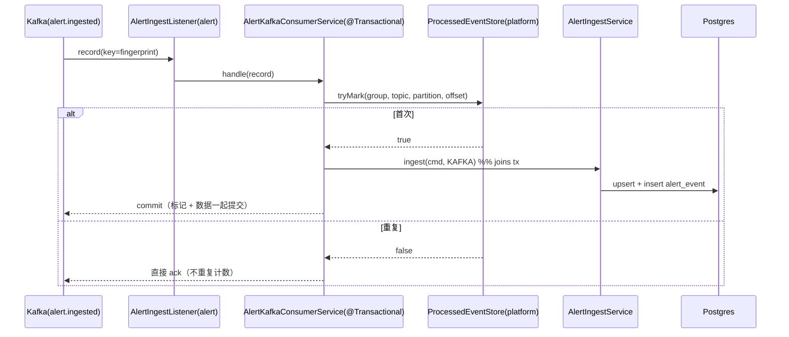
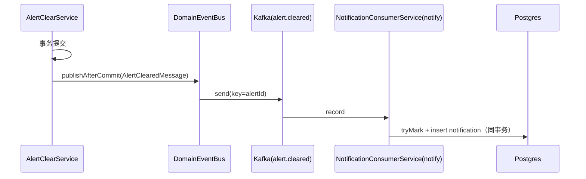
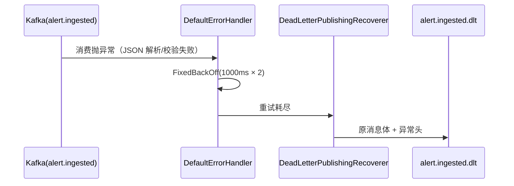

# LLD-05 平台横切与消息链路（platform / notify）

> 状态：v0.9 待评审。承接 T10（Kafka 两链路 + 幂等 + DLT），并为 T01/T03/T08 提供横切件。
> 契约见 `02b-contract.md §0.3 §0.6 §2.5–§2.7 §6.3`；设计见 `02-design.md §5 §6`。

## 1. 范围与边界

**platform 提供（被所有模块依赖，自身无业务依赖）**：

| 组件 | 位置（包） | 作用 |
|---|---|---|
| `@Auditable` | `platform.audit` | 业务动作审计注解（`action/targetType/targetIdParam`） |
| `AuditAction` / `Outcome` / `ActorType` / `TargetType` | `platform.audit` | 枚举（契约 §1.2 §1.3） |
| `AccessDeniedAuditPort` | `platform.audit` | 403 审计端口（`audit` 实现） |
| `AuditTargetResolver` | `platform.audit` | 审计快照 SPI（`alert` 实现 `ALERT`） |
| `@RequirePermission` | `platform.security` | 权限注解（`security` 拦截） |
| `DomainEventBus` | `platform.event` | `publish` / `publishAfterCommit` |
| `AlertIngestedMessage` / `AlertClearedMessage` | `platform.event` | Kafka 消息契约（ADR-0007） |
| `ApiError` / `ApiErrorCode` / `BizException` | `platform.error` | 统一错误 envelope 与业务异常 |
| `GlobalExceptionHandler` | `platform.error` | 异常 → envelope（含 400/404/409/422/500） |
| `TraceIds` + `TraceIdFilter` | `platform.web` | `X-Trace-Id` 生成/透传 + MDC |
| `Severities` | `platform.domain` | 枚举解析与 rank 比较（唯一实现） |
| `Ids` | `platform.domain` | UUID 生成（便于测试替换） |
| `ProcessedEventStore` | `platform.kafka` | 幂等台账（参与调用方事务） |
| `KafkaErrorHandlingConfig` | `platform.kafka` | 重试 + DLT（复用自动配置 `KafkaTemplate`） |

**notify 负责**：消费 `alert.cleared` → 写 `notification` 一行（证明链路通）。

**明确不负责**：

- 消费 `alert.ingested` 的监听器在 `alert` 模块（因为它要调 `AlertIngestService`），platform 只提供幂等与错误处理件。
- 不建业务表（`processed_event` / `notification` 属于基础设施与 notify 自身）。
- 不提供任何 HTTP 端点（`/actuator/health` 由 `:app` 的 actuator 提供）。

**依赖**：`platform → （无）`；`notify → platform`。`alert`/`audit`/`ai`/`security` 都依赖 platform。

## 2. 领域模型

| 对象 | 说明 |
|---|---|
| `DomainEventBus` | `publish(Object)`；`publishAfterCommit(Object)` 用 `TransactionSynchronizationManager`，无事务即发 |
| `ApiError(code, message, traceId)` | 响应体；三字段恒存在 |
| `ApiErrorCode` | 枚举：`code + HttpStatus`（契约 §4 的 11 项） |
| `BizException(ApiErrorCode, String message)` | 业务异常；不抛裸 `RuntimeException` |
| `TraceIdHolder` | `X-Trace-Id` → MDC `traceId` → 响应体 `traceId` |
| `Severities` | `parse(String)`、`rank(Severity)`、`max(a,b)` |
| `ProcessedEventStore#tryMark(group, topic, partitionNo, offset)` | 返回 `true=首次处理`，`false=重复`；**不自己开事务** |
| `AlertClearedMessage` | 见契约 §6.3 |
| `NotificationWriter` | notify 内部，写 `notification` |

不变量：

- **I-PF-1** platform 不得依赖任何业务模块（ArchUnit）。
- **I-PF-2** 幂等标记与业务处理**同一事务**：业务失败 → 标记回滚 → 重投可再次处理（不允许「标记成功但业务丢了」）。
- **I-PF-3** 事件只在事务提交后发；回滚不发（`02-design.md §5.3`）。
- **I-PF-4** 不手写 `ProducerFactory`/`KafkaTemplate` bean；它们来自 Boot 自动配置。
- **I-PF-5** DLT topic 名由 `topic + app.kafka.dlt-suffix` 拼出，不硬编码。
- **I-PF-6** 消费者不得吞异常后正常返回。

## 3. 数据访问

### 3.1 `processed_event`（幂等）

```sql
insert into processed_event (consumer_group, topic, partition_no, record_offset, processed_at)
values (:group, :topic, :partition, :offset, now())
on conflict (consumer_group, topic, partition_no, record_offset) do nothing
returning 1;
```

- 返回 1 行 → 首次；0 行 → 重复，调用方直接 ack。
- 必须在调用方事务内执行（`ProcessedEventStore` 不开事务），否则 I-PF-2 不成立。
- 清理：本期不清理；二期按 `processed_at` 归档。

### 3.2 `notification`（notify）

```sql
insert into notification (id, alert_id, channel, payload, created_at)
values (:id, :alertId, 'LOG', :payload::jsonb, now());
```

告警侧可见性（供 T10 验收）：`select count(*) from notification where alert_id = :alertId` 应为 1。

## 4. 关键时序

### 4.1 Kafka 入口摄入（幂等在同一事务）



断言：同一条消息投两次 → `occurrence_count` 只 +1；`alert_event` 只 +1；业务失败时 `processed_event` 无该行（重投可重试）。

### 4.2 清除事件 → notify



断言：清除失败（回滚）→ Kafka 无消息、`notification` 无行；成功 → `key=alertId`、1 行通知。

### 4.3 非法消息 → 重试 → DLT



断言：手工投 `{"broken"` → 重试 2 次后 DLT 有 1 条；主 topic 无对应数据行。

## 5. 接口清单

**platform 不暴露 HTTP 端点。** 对外只有两类契约：

| 类型 | 内容 |
|---|---|
| 注解 | `@Auditable`、`@RequirePermission` |
| 端口/SPI | `AccessDeniedAuditPort`、`AuditTargetResolver`、`DomainEventBus` |
| 消息 | `AlertIngestedMessage`（`alert.ingested`）、`AlertClearedMessage`（`alert.cleared`） |

错误 envelope 的字段与错误码见 `02b-contract.md §0.3 §4`。

## 6. 事务与一致性

| 组件 | 事务 | 说明 |
|---|---|---|
| `AlertKafkaConsumerService.handle(...)`（alert） | `@Transactional` | 幂等标记 + 摄入同一事务 |
| `NotificationConsumerService.handle(...)`（notify） | `@Transactional` | 幂等标记 + 通知同一事务 |
| `ProcessedEventStore.tryMark(...)`（platform） | **无注解** | 参与调用方事务；单独调用会各自提交（禁止单独用） |
| `DomainEventBus.publishAfterCommit(...)` | 无 | 注册同步回调；无事务立即发 |

- 消费者事务内**不得**再做外部 IO（模型调用、HTTP）；本期消费者只写库。
- 禁止在事务体内直接 `kafkaTemplate.send(...)`；发送只能经 `DomainEventBus.publishAfterCommit`。
- 消费者 `handle` 抛异常 → 交给 `DefaultErrorHandler`；不得 try-catch 后返回正常。

## 7. 错误与审计点

| 场景 | 行为 | 审计 |
|---|---|---|
| 业务异常（`BizException`） | `GlobalExceptionHandler` → 对应 `code`/HTTP | 由切面（若在 `@Auditable` 范围内） |
| 参数校验失败（`MethodArgumentNotValidException`） | 400 `VALIDATION_FAILED`，message 取首个字段错误 | 无 |
| 未预期异常 | 500 `INTERNAL_ERROR`，日志带 traceId，响应不带堆栈 | 无 |
| 404 路径不存在 | 404 `NOT_FOUND` | 无 |
| 415/405 | 405 `METHOD_NOT_ALLOWED` / 400 | 无 |
| Kafka 消费失败 | 重试 2 次 → DLT | 无 |

- `GlobalExceptionHandler` 必须**不拦截** `AccessDeniedException`（它在过滤器链已被处理），否则 403 会变成 500。
- platform 自身不写审计；审计写入只在 `audit`。
- 日志：`action={} alertId={} traceId={}`，禁止请求体与完整 IP。

## 8. 配置与运行

| 键 | 默认 | 说明 |
|---|---|---|
| `spring.kafka.bootstrap-servers` | env `KAFKA_BOOTSTRAP` | 自动配置 |
| `spring.kafka.consumer.auto-offset-reset` | `earliest` | 演示环境 |
| `spring.kafka.consumer.enable-auto-commit` | `false` | 由监听器容器提交 |
| `app.kafka.dlt-suffix` | `.dlt` | DLT 后缀 |
| `app.kafka.topics.ingested` | `alert.ingested` | |
| `app.kafka.topics.cleared` | `alert.cleared` | |
| `app.kafka.consumer.group.ingest` | `triagedeck-alert-ingest` | |
| `app.kafka.consumer.group.notify` | `triagedeck-notify` | |

- topic 由 compose 的 `kafka-init` 一次性创建（4 个：两个主 + 两个 DLT），`auto.create.topics.enable=false`。
- 设备模拟器：`tools/device-simulator`（Gradle 模块 `:device-simulator`），用 `kafka-clients` 直接 `KafkaProducer` 投 10 条；**工具不参与应用运行**，因此不受「不手写 ProducerFactory」约束（该约束针对应用 bean）。
- `spring.kafka` 的序列化：值用 `StringSerializer`/`StringDeserializer`，应用层用 Jackson 解析（错误可控，便于 DLT）。

## 9. 测试计划

| 类型 | 用例 | 覆盖 | 「改坏必然红」的断言 |
|---|---|---|---|
| 单测 | `ApiErrorSerializationTest.should_emit_three_fields()` | NFR | 序列化后仅有 `code/message/traceId` |
| 单测 | `DomainEventBusTest.should_not_publish_when_rollback()` | B1 C2 | 回滚后发布次数 = 0 |
| 单测 | `SeveritiesTest.should_max_never_downgrade()` | B2 | `max(CRITICAL, LOW)=CRITICAL` |
| 集成 | `KafkaIngestIT.should_ingest_10_messages_within_3s()` | B1 | 10 条入 `alerts_active`，耗时 <3s |
| 集成 | `KafkaIngestIT.should_process_once_when_duplicated()` | B1 | 同消息两次 → count 只 +1、`processed_event` 1 行 |
| 集成 | `KafkaIngestIT.should_route_invalid_json_to_dlt()` | B1 | DLT 有 1 条、主表无新增 |
| 集成 | `ClearPublishIT.should_publish_after_commit_and_write_notification()` | B5 B1 | `notification` 1 行、key=alertId |
| 集成 | `ClearPublishIT.should_not_publish_on_rollback()` | B5 | Kafka 无消息、notification 0 行 |
| 集成 | `ErrorEnvelopeIT.should_return_unified_error_shape()` | NFR | 400/404/409 三个场景都只有三字段 |
| ArchUnit | `PlatformArchTest` / `NotifyArchTest` | — | platform 不依赖业务；notify 只依赖 platform |

验收命令：

```bash
./gradlew :platform:test :notify:test
./gradlew :device-simulator:run --args="--count=10 --mode=kafka"
docker compose exec kafka /opt/kafka/bin/kafka-console-consumer.sh --bootstrap-server localhost:9092 --topic alert.cleared --max-messages 1
```

## 附录 A：待确认项

| # | 问题 | 建议 | 结论 |
|---|---|---|---|
| A1 | `processed_event` 是否需要 TTL 清理 | 本期不清理（数据量小），二期归档 | |
| A2 | DLT 是否需要人工重放入口 | 本期不做，二期加脚本 | |
| A3 | notify 只写 DB 是否足够体现「下游收到」 | 足够（T10 验收即可查 `notification`） | |
| A4 | 模拟器放 Gradle 模块还是脚本 | Gradle 模块 `:device-simulator`，便于 `./gradlew :device-simulator:run` | |
